<p align="center">
  
</p>

<h1 align="center">CaramOS</h1>

<p align="center">
  <strong>Sweet & Simple Linux — Hệ điều hành Linux ngọt ngào cho người Việt</strong>
</p>

<p align="center">
  <em>Caram = Carambola = Trái khế — 5 cánh như ngôi sao trên quốc kỳ, gắn liền với tuổi thơ người Việt</em>
</p>

<p align="center">
  <a href="https://github.com/VN-Linux-Family/CaramOS/releases/tag/v1.3.2"></a>
  
  
  <a href="LICENSE"></a>
</p>

<p align="center">
  <a href="https://sourceforge.net/projects/caramos/files/v1.3.2/CaramOS-1.3.2-cinnamon-amd64.iso/download"><strong>Tải CaramOS 1.3.2</strong></a> ·
  <a href="https://caramos.vietnamlinuxfamily.net">Website</a> ·
  <a href="README_EN.md">English</a> ·
  <a href="https://vietnamlinuxfamily.net">VNLF</a>
</p>

<p align="center">
  Phát triển bởi: <a href="https://www.facebook.com/groups/vietnamlinuxcommunity">VNLF</a> · <a href="https://www.facebook.com/mrd.900s/">MRD</a> · <a href="https://www.facebook.com/tam.nguyet.that">Kỳ Nguyễn</a>
</p>

<p align="center">
  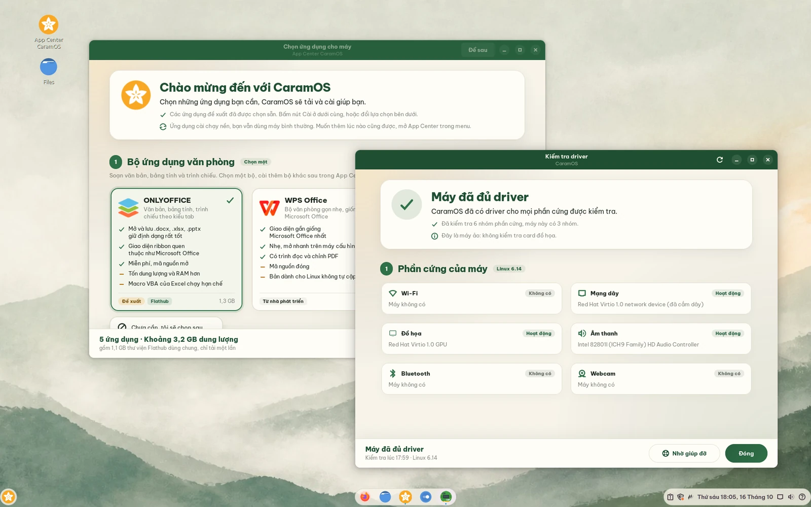
</p>

---

## CaramOS là gì?

**CaramOS** là bản phân phối Linux dựa trên **Linux Mint 22.3 Cinnamon** (nền Ubuntu 24.04 LTS),
làm riêng cho **người dùng Việt Nam**. Mục tiêu của CaramOS là phổ thông hoá Linux: người đang dùng
Windows chuyển sang mà không phải mày mò, có sẵn tiếng Việt, bộ gõ, giao diện thân thiện, và mọi thứ
khác chỉ cần vài cú bấm.

> [!IMPORTANT]
> **CaramOS 1.3.2 là bản mới nhất** của dòng phát hành chính thức (Official Release) bắt đầu từ 1.3.0,
> sau chuỗi bản Open Beta 1.0.x.
>
> - **Cài mới:** [tải ISO 1.3.2](https://sourceforge.net/projects/caramos/files/v1.3.2/CaramOS-1.3.2-cinnamon-amd64.iso/download)
>   (2,8 GB) · [SHA256SUMS](https://github.com/VN-Linux-Family/CaramOS/releases/download/v1.3.2/SHA256SUMS) ·
>   [ghi chú phát hành](https://github.com/VN-Linux-Family/CaramOS/releases/tag/v1.3.2)
> - **Đang dùng CaramOS 1.0.2 trở lên:** không cần cài lại. Trung tâm cập nhật tự báo bản 1.3.2, bấm
>   **Cập nhật ngay** là xong. Xem [Nâng cấp từ bản cũ](#nâng-cấp-từ-bản-cũ).

## Có gì mới

### 1.3.2

- **Cài được Zalo trở lại:** Zalo cho Linux bản mới gọi thoại, gọi video ngay trên Linux, không cần Wine nên
  mở nhanh hơn. App Center cài bản này; máy đã có Zalo được Trung tâm cập nhật đổi sang bản mới, tải ngầm và
  tự thử lại mỗi ngày nếu mạng chập chờn.
- **Biểu tượng giữa thanh tác vụ nằm gọn trong khung** sau bản cập nhật Cinnamon 6.6.9; từ nay CaramOS tự sửa
  lại mỗi khi Cinnamon được cập nhật.
- **Kiểm tra driver không còn làm đứng máy cũ** khi chạy thử từ USB, và nói rõ vì sao loa, micro, camera chưa
  chạy trên máy tính bảng chip Intel Atom như Lenovo Yoga Book.
- **Nhờ giúp đỡ kèm nhật ký:** App Center hay Trung tâm cập nhật cài không được thì nút **Nhờ giúp đỡ** gửi
  yêu cầu kèm nhật ký lỗi; Kiểm tra driver và Góp ý & hỗ trợ kèm nhật ký hệ thống. Chỉ đội VNLF xem được nhật
  ký, thông tin cá nhân đã được xoá trước khi gửi.
- **Trình cài đặt không còn dừng ngay khi mở** (lỗi `_on_got_unit_proxy`) và không còn khoá việc cài phần mềm
  khác trong phiên chạy thử.

### 1.3.1

- **Start Menu tiếng Việt trọn vẹn:** "Tất cả ứng dụng", "Biểu tượng cảm xúc" thay cho chữ tiếng Anh;
  applet thời tiết và các tiện ích mở rộng đi kèm cũng theo ngôn ngữ của máy.
- **Trung tâm cập nhật toàn tiếng Việt:** dòng dung lượng của bản cập nhật không còn lẫn chữ tiếng Anh.
- **App Center ghi rõ nguồn cài:** Zalo cho Linux hiện nhãn **Gói cộng đồng**, vì do cộng đồng đóng gói chứ
  không phải của Zalo.

### 1.3.0 — bản phát hành chính thức đầu tiên

- **App Center:** lần đăng nhập đầu tiên chọn bộ văn phòng, trình duyệt, ứng dụng liên lạc và tiện ích;
  CaramOS tải và cài giúp. Gỡ ứng dụng ngay trên thẻ của nó.
- **Kiểm tra driver:** tự kiểm tra phần cứng ở lần đăng nhập đầu tiên và khi chạy thử từ USB, cài driver
  NVIDIA và Wi-Fi Broadcom bằng một nút.
- **Góp ý & hỗ trợ:** dấu hỏi ở góc phải thanh tác vụ, gửi câu hỏi, báo lỗi, góp ý kèm ảnh hoặc video
  tới cộng đồng Vietnam Linux Family, và được báo khi có người trả lời.
- **Trung tâm cập nhật mới:** giao diện màu VNLF, ghi rõ từng thay đổi, nút **Cập nhật ngay** luôn ở
  đáy cửa sổ.
- **Nhẹ hơn Linux Mint gốc:** ít dịch vụ nền hơn, ít RAM hơn, và tự xử lý khi RAM sắp đầy thay vì để
  máy đơ. ISO 2,8 GB, nhỏ hơn ISO Linux Mint 22.3 (3,1 GB).
- **Không cài sẵn những thứ bạn không chọn:** WPS Office, Chrome và Zalo giờ nằm trong App Center,
  CopyQ không còn tự chạy, 14 màu biểu tượng thừa (khoảng 1,1 GB) được dọn khỏi máy.

## Tính năng nổi bật

### App Center — chọn ứng dụng, CaramOS cài giúp

<p align="center">
  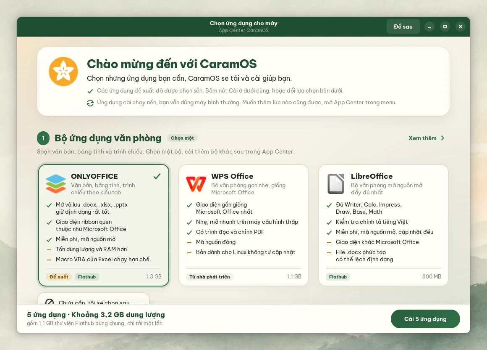
</p>

Lần đăng nhập đầu tiên, App Center mở ra với một trang duy nhất chia theo nhóm. Bộ đề xuất đã được chọn
sẵn: chỉ cần bấm **Cài** ở cuối trang, rồi dùng máy bình thường trong lúc CaramOS tải và cài.

- **Bộ văn phòng:** ONLYOFFICE, WPS Office, LibreOffice.
- **Trình duyệt:** Google Chrome, Cốc Cốc, Microsoft Edge, Brave, Firefox.
- **Liên lạc và họp trực tuyến:** Zalo (gọi thoại, gọi video được), Telegram, Zoom, Teams for Linux, Discord.
- **Tiện ích:** font Microsoft (Times New Roman, Arial...), VLC, OBS Studio, RustDesk, GIMP, Thunderbird.

<table>
  <tr>
    <td align="center"></td>
    <td align="center"></td>
  </tr>
</table>

Mỗi ứng dụng ghi rõ ưu và nhược điểm, dung lượng, và nguồn cài: Flathub, kho Ubuntu hay gói tải về. Ứng
dụng đã cài có nút **Gỡ cài đặt** ngay trên thẻ. Mở lại App Center bất cứ lúc nào từ biểu tượng trên
Desktop hoặc menu; cần thêm ứng dụng khác thì nút **Xem thêm** dẫn tới
[apps.vietnamlinuxfamily.net](https://apps.vietnamlinuxfamily.net).

### Kiểm tra driver — biết ngay máy còn thiếu gì

<p align="center">
  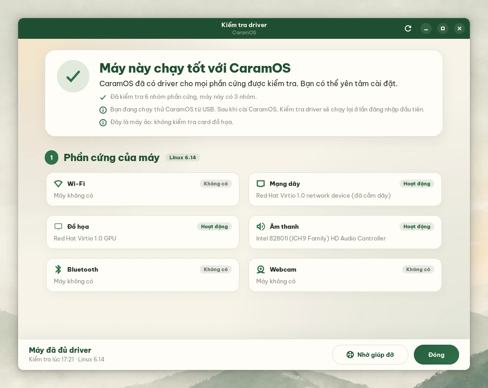
</p>

Ngay khi chạy thử CaramOS từ USB, Kiểm tra driver cho bạn biết máy có hợp với CaramOS không, trước khi
cài. Sau khi cài, nó chạy lại ở lần đăng nhập đầu tiên, rồi chỉ lên tiếng khi có vấn đề mới.

- Kiểm tra Wi-Fi, mạng dây, card đồ họa, âm thanh, Bluetooth, webcam và đầu đọc vân tay.
- Cài driver **NVIDIA** và **Wi-Fi Broadcom** bằng một nút, đúng bản Ubuntu khuyên dùng cho máy.
- Thiếu driver mạng nên máy chưa vào được Internet? Nó chỉ cách vào mạng bằng dây LAN, điện thoại qua
  USB, hoặc cài driver Broadcom ngay từ USB cài CaramOS.
- Giải thích từng trường hợp: chưa có driver trong kernel, driver chờ khởi động lại, driver bị chặn
  (blacklist, Secure Boot), thiếu firmware.
- Không tự xử lý được? Nút **Nhờ giúp đỡ** gửi lời nhắn kèm hồ sơ phần cứng `hw-probe` tới cộng đồng VNLF.

### Trung tâm cập nhật — nâng cấp không cần cài lại

<p align="center">
  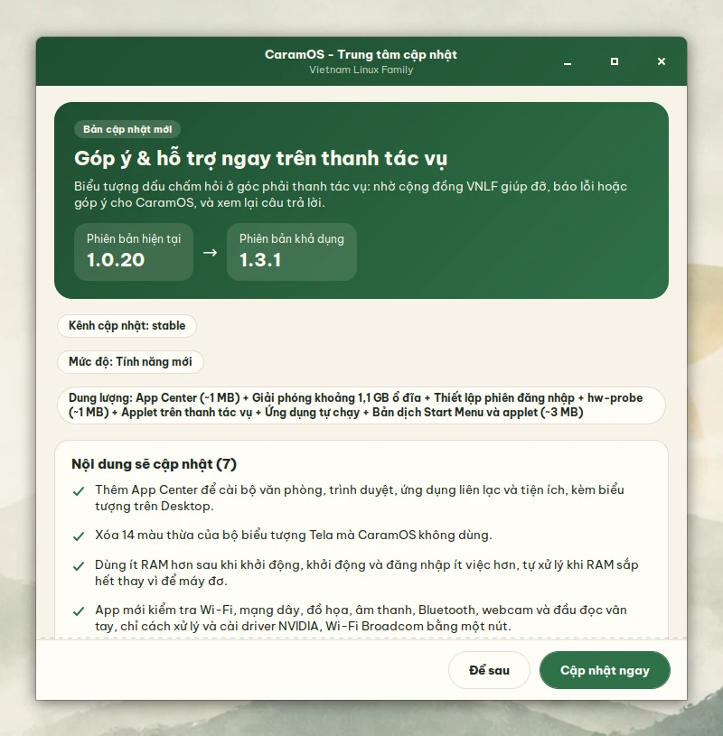
</p>

CaramOS cập nhật qua **OTA**: máy cài từ bản nào cũng lên được bản mới nhất mà không phải cài lại hay
mất dữ liệu.

- Mỗi ngày CaramOS kiểm tra một lần. Có bản mới thì Trung tâm cập nhật báo phiên bản hiện tại, phiên bản
  mới và từng thay đổi sẽ được áp dụng.
- Không có gì tự cài khi bạn chưa đồng ý: bấm **Cập nhật ngay** khi tiện, hoặc **Để sau**.
- Thứ bạn đã tự chỉnh được giữ nguyên: hình nền bạn tự chọn, bộ màu biểu tượng bạn đang dùng, applet bạn
  đã gỡ khỏi thanh tác vụ.

### Control Center — mọi thiết lập nhanh trong một chạm

<table>
  <tr>
    <td align="center">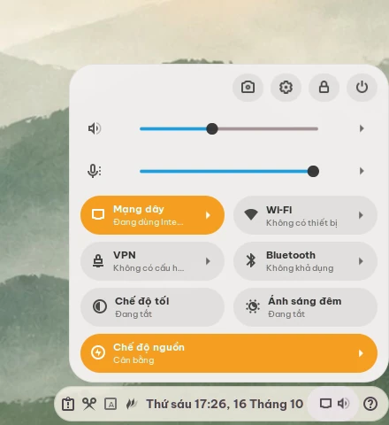</td>
    <td align="center">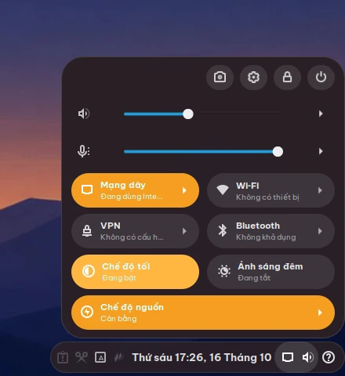</td>
  </tr>
</table>

Bấm vào góc phải thanh tác vụ để mở Control Center, thay cho các applet mạng, âm thanh và pin rời rạc
của Cinnamon:

- Âm lượng loa và micro, chọn thiết bị phát và thu.
- Mạng dây, Wi-Fi, VPN và Bluetooth, mỗi ô có danh sách riêng để chọn nhanh.
- **Chế độ tối** cho cả hệ thống, **Ánh sáng đêm**, và **Chế độ nguồn** (Hiệu năng, Cân bằng, Tiết
  kiệm pin).
- Độ sáng màn hình và pin trên laptop, nút chụp màn hình, mở Cài đặt, khoá máy và tắt máy.

### Góp ý & hỗ trợ — cộng đồng VNLF ngay trên thanh tác vụ

<table>
  <tr>
    <td align="center" width="42%">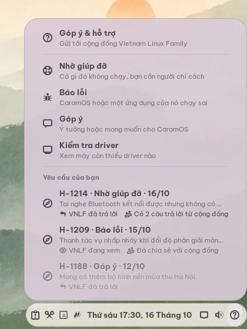</td>
    <td align="center">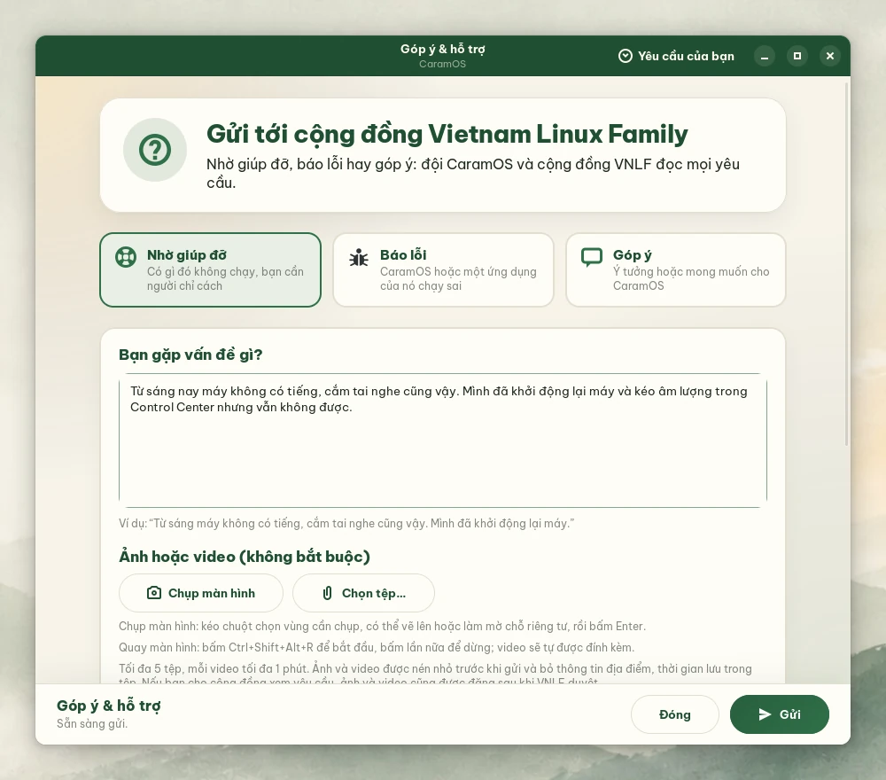</td>
  </tr>
</table>

Dấu hỏi ở góc phải thanh tác vụ là đường tắt tới cộng đồng **Vietnam Linux Family**:

- **Nhờ giúp đỡ** khi có gì đó không chạy, **Báo lỗi** khi CaramOS hoặc một ứng dụng chạy sai, **Góp ý**
  khi bạn có ý tưởng cho CaramOS.
- Kèm ảnh chụp màn hình (làm mờ được chỗ riêng tư), video quay màn hình tối đa 1 phút, hoặc ảnh và video
  có sẵn trong máy. Ảnh và video được nén nhỏ và bỏ thông tin vị trí trước khi gửi.
- Kèm hồ sơ phần cứng và kết quả Kiểm tra driver nếu bạn đồng ý, để người giúp thấy đúng máy của bạn.
  Hồ sơ phần cứng không có tên người dùng, tên máy và địa chỉ IP.
- Yêu cầu được chia sẻ để cộng đồng cùng giúp (bỏ tick được); VNLF duyệt trước khi đăng, thông tin liên
  hệ không công khai.

<table>
  <tr>
    <td align="center">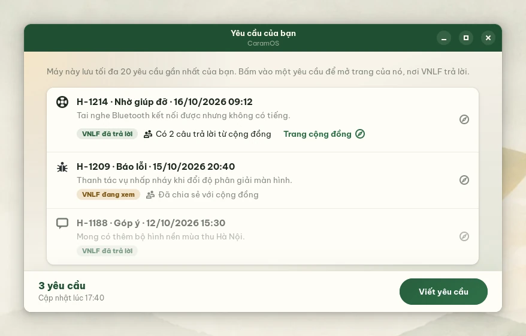</td>
    <td align="center">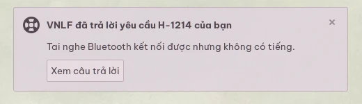</td>
  </tr>
</table>

Menu và cửa sổ **Yêu cầu của bạn** cho biết VNLF đang xem, đã trả lời hay đã xử lý xong, và cộng đồng đã
có bao nhiêu câu trả lời. Có câu trả lời mới, CaramOS gửi thông báo; bấm vào là mở đúng trang của yêu cầu.

### Island Dock — thanh tác vụ ba đảo

<p align="center">
  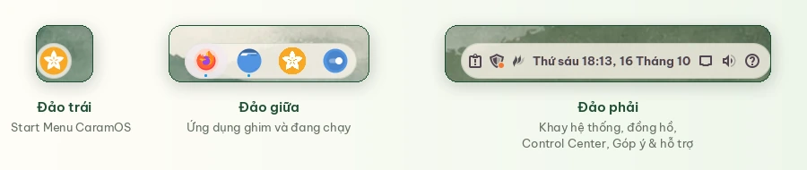
</p>

Thanh tác vụ của CaramOS tách thành ba "đảo" nổi, bo tròn, cách đều nhau:

- **Bên trái:** nút Start Menu CaramOS.
- **Ở giữa:** ứng dụng ghim và ứng dụng đang chạy, có chấm nhỏ dưới ứng dụng đang mở.
- **Bên phải:** khay hệ thống, bộ gõ, đồng hồ, Control Center và Góp ý & hỗ trợ.

### Giao diện sáng – tối, đồng bộ từ lúc bật máy

<p align="center">
  
</p>

- Theme Cinnamon Delight, biểu tượng Tela Circle, con trỏ Bibata, font **Be Vietnam Pro**.
- Chế độ tối một chạm trong Control Center; hình nền tự đổi theo (Sage Mist khi sáng, Indigo Night khi
  tối). Bộ 5 hình nền CaramOS 2048×1152.
- Menu khởi động, màn hình chờ, trình cài đặt và cả menu GRUB trên máy cài song song nhiều hệ điều hành
  đều mang giao diện CaramOS.

### Tiếng Việt từ đầu

<p align="center">
  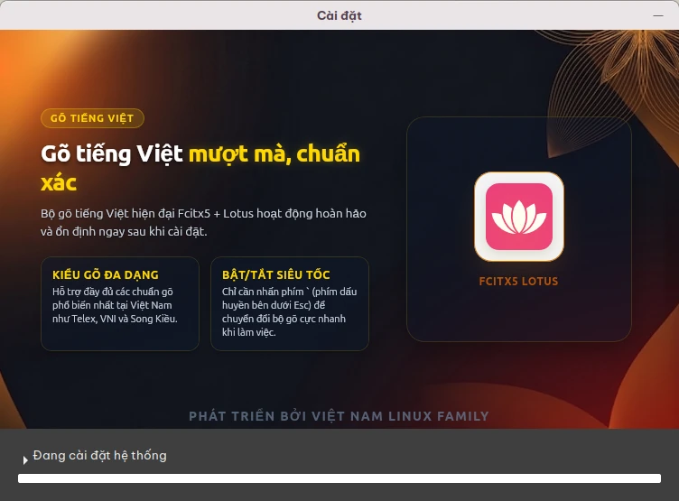
</p>

- Giao diện tiếng Việt, múi giờ Asia/Ho_Chi_Minh, định dạng ngày giờ Việt Nam. Chọn ngôn ngữ khác trong
  Cài đặt > Ngôn ngữ thì cả hệ thống theo.
- Bộ gõ **Fcitx5 + Lotus** bật sẵn: mặc định Telex, có VNI và các kiểu gõ phổ biến khác. **Ctrl+Shift**
  chuyển tiếng Anh/tiếng Việt, phím **`** (dưới Esc) mở menu đổi kiểu gõ.
- Ứng dụng cài từ Flathub vẫn gõ tiếng Việt và dùng font của hệ thống bình thường.

### Nhẹ và ổn định

- Nền **Linux Mint 22.3 / Ubuntu 24.04 LTS**, được cập nhật bảo mật đến năm 2029.
- **Ít RAM hơn:** máy rảnh dùng 865 MiB RAM, Linux Mint 22.3 gốc dùng 941 MiB (cùng máy ảo 4 nhân,
  6 GB RAM, đo 5 phút sau khi khởi động).
- Ít dịch vụ nền hơn Linux Mint gốc: không nạp OpenGL vô ích cho các dịch vụ của Cinnamon, bộ gõ không
  khởi động portal thừa, dịch vụ nhắc lịch chỉ chạy khi bạn có lịch, bỏ dịch vụ báo lỗi kernel cho
  Ubuntu.
- **earlyoom:** khi RAM và swap gần hết, CaramOS đóng ứng dụng tốn RAM nhất thay vì để cả máy treo. Trên
  máy thử với ổ cứng chậm, Linux Mint gốc đơ hơn 30 phút trong tình huống này, CaramOS không lần nào đứng
  hình.
- ISO 2,8 GB, nhỏ hơn ISO Linux Mint 22.3 (3,1 GB) dù có thêm App Center, Kiểm tra driver và Góp ý & hỗ
  trợ.

## Trải nghiệm CaramOS

| | |
|---|---|
| **Menu khởi động**<br>Chạy thử CaramOS từ USB hoặc cài vào máy. | 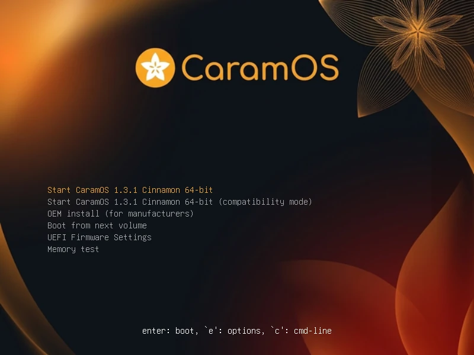 |
| **Trình cài đặt**<br>Slideshow giới thiệu App Center, bộ gõ và cộng đồng trong lúc cài. | 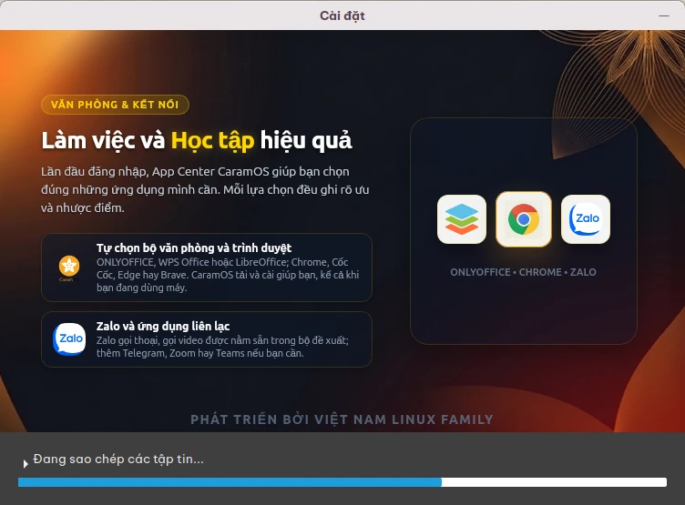 |
| **Start Menu**<br>Tìm ứng dụng bằng tiếng Việt, gõ không dấu vẫn ra. | 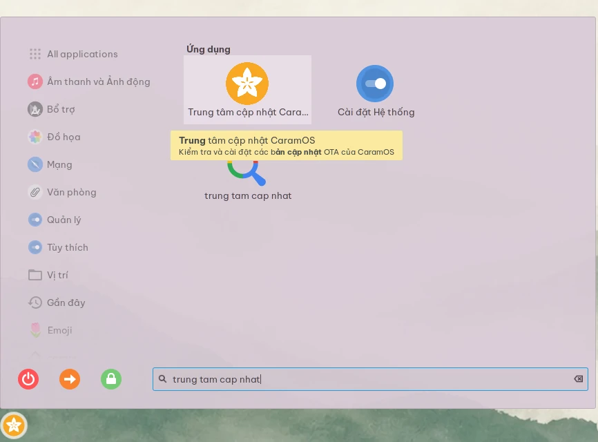 |
| **Terminal**<br>Nhận diện CaramOS ngay trong `neofetch`. | 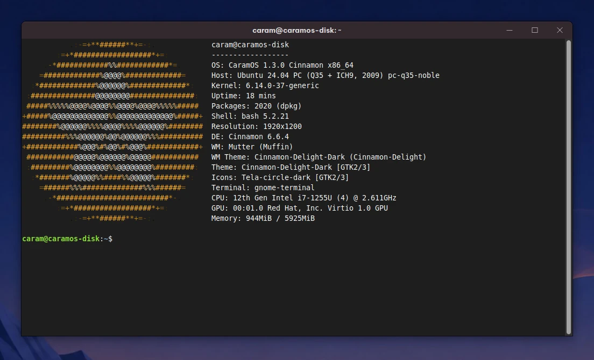 |

<p align="center">
  
</p>

## Tải và cài đặt

### Yêu cầu máy

- Máy tính 64-bit (x86_64), UEFI hoặc BIOS.
- RAM 2 GB trở lên, khuyên dùng 4 GB.
- Ổ đĩa trống 20 GB trở lên, khuyên dùng 100 GB.
- USB từ 4 GB để tạo bộ cài.

### 1. Tải ISO

- [CaramOS-1.3.2-cinnamon-amd64.iso](https://sourceforge.net/projects/caramos/files/v1.3.2/CaramOS-1.3.2-cinnamon-amd64.iso/download)
  (2,8 GB, trên SourceForge vì GitHub giới hạn dung lượng mỗi tệp đính kèm).
- [SHA256SUMS](https://github.com/VN-Linux-Family/CaramOS/releases/download/v1.3.2/SHA256SUMS) để kiểm tra
  tệp tải về:

```bash
sha256sum -c SHA256SUMS
```

### 2. Ghi ra USB

Dùng [balenaEtcher](https://etcher.balena.io), [Ventoy](https://www.ventoy.net) hoặc Rufus (Windows).
Trên Linux có thể dùng `dd`:

```bash
sudo dd if=CaramOS-1.3.2-cinnamon-amd64.iso of=/dev/sdX bs=4M status=progress oflag=sync
```

### 3. Chạy thử và cài đặt

1. Khởi động lại máy, vào menu chọn thiết bị khởi động (thường là F12, F10, F2, Esc hoặc Del tuỳ máy) và
   chọn USB.
2. Chọn **Start CaramOS** để chạy thử. Kiểm tra driver tự mở và cho biết máy có chạy tốt với CaramOS không.
3. Mở biểu tượng **Cài đặt CaramOS** trên Desktop và làm theo hướng dẫn.

## Nâng cấp từ bản cũ

Máy đã cài CaramOS không cần cài lại ISO.

- **Từ CaramOS 1.0.2 trở lên:** Trung tâm cập nhật tự kiểm tra mỗi ngày và báo bản 1.3.2; bấm **Cập nhật
  ngay**. Muốn nâng cấp liền, mở Terminal và chạy:

  ```bash
  sudo caramos-ota --upgrade --yes
  ```

- **Từ CaramOS 1.0.1:** cài Trung tâm cập nhật một lần, rồi mở **Trung tâm cập nhật CaramOS** từ Start
  Menu:

  ```bash
  curl -fsSL https://caramos.vietnamlinuxfamily.net/install-caramos-ota.sh | sudo bash
  ```

---

## Dành cho nhà phát triển

> [!NOTE]
> Không code trực tiếp các thay đổi hệ thống vào `config/hooks/live/` nếu thay đổi đó cần đến được máy
> người dùng đã cài. Hãy viết migration trong `packages/caramos-ota`. Xem hướng dẫn phát triển OTA:
> [packages/caramos-ota/README.md](packages/caramos-ota/README.md).

### Công nghệ sử dụng

| Thành phần | Công nghệ / vai trò hiện tại |
|---|---|
| **Base ISO** | Linux Mint 22.3 Cinnamon 64-bit |
| **Ubuntu base** | Ubuntu 24.04 LTS / noble |
| **Desktop** | Cinnamon + LightDM theo Linux Mint base |
| **Build method** | ISO remaster: extract → customize → OTA bootstrap → repack |
| **Build scripts** | Bash + Makefile, tách module trong `scripts/` |
| **OTA** | `caramos-ota`: timestamp migrations chạy theo ledger, phát hành qua PPA `ppa:vietnamlinuxfamily/caram-os` |
| **Update Center** | `caramos-ota-notifier` + `pkexec caramos-ota --upgrade --yes` |
| **App Center** | `caramos-app-center` (Python, GTK4, libadwaita), repo riêng, phát hành bằng GitHub Release có chữ ký |
| **Kiểm tra driver, Góp ý & hỗ trợ** | `caramos-driver-check`, `caramos-help` (GTK4, libadwaita) và applet Cinnamon `caramos-help@caramos`, trong gói `caramos-ota` |
| **Control Center** | Applet Cinnamon `caramos-control-center@caramos` |
| **Legacy hooks** | `config/hooks/live/` chỉ dùng cho bootstrap/build-time nền tảng, không là nơi phát triển feature OTA mới |
| **Overlay** | `config/includes.chroot/` chứa file nền cần có trong ISO/rootfs |
| **Compression** | SquashFS `lz4` cho dev, `xz` cho release |
| **Theme / Icon / Cursor** | Cinnamon Delight, Tela Circle, Bibata |
| **Font / Input** | Be Vietnam Pro, Fcitx5 + Lotus |
| **Apps có sẵn** | Firefox; còn lại cài qua App Center (Flathub, kho Ubuntu hay gói tải về) |

### Cấu trúc dự án

```text
./
├── build.sh                         # Script build chính
├── Makefile                         # Target build/dev/release/debug
├── scripts/                         # Module build ISO
│   ├── config.sh                    # Version ISO, base migration version, mirror, output
│   ├── utils.sh                     # Log, deps, download ISO, mount helpers
│   ├── extract.sh                   # Mount ISO + rsync + unsquashfs
│   ├── customize.sh                 # Chroot + packages + overlay + hooks + OTA bootstrap
│   ├── ota_bootstrap.sh             # Build caramos-ota, App Center .deb và chạy migration vào ISO rootfs
│   ├── repack.sh                    # mksquashfs + xorriso
│   ├── boot_config.sh               # Boot menu + Plymouth branding
│   ├── overlay.sh                   # Copy config/includes.chroot vào rootfs
│   ├── chroot_shell.sh              # Debug chroot
│   └── debug_iso.sh                 # Kiểm tra ISO/boot branding
├── config/                          # Lớp bootstrap ISO/rootfs
│   ├── packages.txt                 # Packages nền cài thêm khi build ISO
│   ├── hooks/live/                  # Hook build-time legacy, hạn chế thêm logic mới
│   └── includes.chroot/             # Overlay copy trực tiếp vào rootfs trước OTA bootstrap
├── packages/                        # Debian packages do CaramOS duy trì
│   ├── caramos-ota/                 # Trung tâm cập nhật, migration, Control Center, Kiểm tra driver, Góp ý & hỗ trợ
│   │   ├── debian/changelog         # Version package OTA publish qua PPA
│   │   ├── usr/bin/                 # caramos-ota, notifier, update runner, caramos-driver-check, caramos-help
│   │   └── usr/lib/python3/dist-packages/caramos_ota_update/migrations/
│   │       ├── v1_0_2 … v1_0_12/    # Migration legacy (đóng băng)
│   │       └── YYYYMMDDHHMMSS_slug/ # Timestamp migration (từ 1.0.13)
│   └── caramos-app-center/          # Git submodule VN-Linux-Family/CaramOS-app-center
├── docs/                            # Tài liệu vận hành/release tracking
├── assets/                          # Logo, banner, ảnh chụp màn hình
├── Dockerfile                       # Docker builder
└── docker-compose.yml               # Docker build entrypoint
```

Landing page [caramos.vietnamlinuxfamily.net](https://caramos.vietnamlinuxfamily.net) nằm ở repo riêng
[VN-Linux-Family/caramos-landing](https://github.com/VN-Linux-Family/caramos-landing).

> [!IMPORTANT]
> `config/hooks/live/` không còn là nơi chính để phát triển cập nhật hệ thống.
> Nếu thay đổi cần áp dụng cho máy người dùng đã cài CaramOS, hãy viết migration
> trong `packages/caramos-ota/usr/lib/python3/dist-packages/caramos_ota_update/migrations/`.

### Version & release model

Version sản phẩm nằm trong source tree, ở [scripts/config.sh](scripts/config.sh):

```bash
CARAMOS_VERSION="1.3.2"
```

`make release VERSION=x.y.z` đóng dấu version này cùng lúc vào `scripts/config.sh`, metadata release và
`debian/changelog` của `caramos-ota`. Version được dùng cho:

- tên ISO: `CaramOS-<version>-cinnamon-amd64.iso`
- boot menu/boot branding
- `/etc/os-release`, `/etc/lsb-release`, `/etc/linuxmint/info`
- `neofetch` / `fastfetch`
- GitHub Release và package `caramos-ota` trên PPA

Khi release, Git tag phải khớp version trong source: version `1.3.2` thì tag là `v1.3.2`. Nếu tag
không khớp, GitHub Actions dừng trước khi build.

### Cập nhật OTA

CaramOS dùng mô hình **OTA-first**. ISO mới vẫn được phát hành, còn máy đã cài từ bản cũ nâng lên bản mới
nhất bằng chuỗi migration đã review:

```text
systemd timer
  └── caramos-ota --check
      ├── cập nhật package caramos-ota nếu PPA có bản mới
      ├── cập nhật App Center từ GitHub Release (đã kiểm tra chữ ký)
      ├── resolve migration chưa chạy theo ledger
      └── ghi /var/lib/caramos-ota/state.json

Update Center
  └── user xác nhận
      └── pkexec caramos-ota --upgrade --yes
          └── caramos-ota-update chạy từng migration
```

Nguyên tắc chính:

- Timer chỉ check/chuẩn bị state, không tự mở GUI và không tự apply migration.
- Migration chỉ chạy khi user xác nhận trong desktop session hoặc admin chạy CLI.
- Logic thay đổi hệ thống nằm trong `packages/caramos-ota`, không nhét vào hook.
- Thay đổi sau release được viết thành timestamp migration (`YYYYMMDDHHMMSS_slug/`), không gắn version.
- ISO build cũng dùng chính chuỗi migration này để đưa rootfs lên bản mới nhất.

Xem chi tiết: [packages/caramos-ota/README.md](packages/caramos-ota/README.md).

### Build ISO local

Khi build ISO, CaramOS không chỉ copy overlay/hook rồi đóng gói lại. Build flow tự build package
`caramos-ota` và App Center, cài vào rootfs và chạy toàn bộ chuỗi OTA migration từ
`CARAMOS_MIGRATION_BASE_VERSION` tới bản mới nhất trước khi repack ISO.

Nói ngắn gọn: **ISO build ra đã là bản mới nhất**, còn OTA là đường nâng cấp cho máy đã cài từ ISO cũ.

Cài dependency build trên Ubuntu/Mint/Debian:

```bash
sudo apt update
sudo apt install squashfs-tools xorriso rsync wget curl isolinux syslinux-common syslinux-utils gettext build-essential debhelper
git submodule update --init
```

Build dev đầy đủ, nén `lz4` để test nhanh:

```bash
make build
```

Build release local, nén `xz` để ISO nhỏ hơn:

```bash
make release VERSION=x.y.z
```

Build từ ISO Mint có sẵn:

```bash
make build ISO=linuxmint-22.3-cinnamon-64bit.iso
```

Trong quá trình `customize`, script sẽ chạy:

```text
extract base ISO
  → install packages + overlay + build-time hooks
  → build/install bundled caramos-ota + caramos-app-center
  → caramos-ota-update --from "$CARAMOS_MIGRATION_BASE_VERSION" --target latest
  → repack squashfs + ISO
```

### Make targets

| Lệnh | Mục đích |
|---|---|
| `make build` | Build dev đầy đủ, nén `lz4` |
| `make release VERSION=x.y.z` | Đóng dấu version và build release, nén `xz` |
| `make prepare` | Bung ISO/rootfs ra `build/` để sửa nhanh |
| `make customize-only` | Chạy packages, overlay và hooks trong rootfs |
| `make overlay` | Chỉ copy `config/includes.chroot` vào rootfs |
| `make quick` | Prepare nếu cần, overlay, repack squashfs và ISO |
| `make repack` | Đóng gói lại squashfs và ISO từ work tree hiện có |
| `make iso-only` | Chỉ tạo lại ISO từ `build/custom` |
| `make boot-only` | Chỉ áp dụng boot menu, GRUB và Plymouth branding |
| `make shell` | Vào chroot `build/squashfs` để debug thủ công |
| `make debug-iso` | Kiểm tra boot menu/Plymouth/branding của ISO |
| `make clean` | Xoá build/cache/output ISO |
| `make clean-work` | Xoá work tree, giữ cache extract |
| `make clean-cache` | Xoá cache extract/work tree |
| `make docker-build` | Build dev trong Docker |
| `make docker-release` | Build release trong Docker |
| `make docker-clean` | Clean build bằng Docker |

Sau lần build/prepare đầu tiên:

- Nếu sửa file bootstrap ISO như wallpaper, asset hoặc overlay nền: dùng `make overlay` rồi `make quick`.
- Nếu sửa package/migration OTA: build/test trong [packages/caramos-ota](packages/caramos-ota/) trước, sau đó chạy `make customize-only` hoặc build lại ISO để OTA bootstrap áp dụng migration vào rootfs.
- Không thêm feature mới vào hook chỉ để cập nhật máy user đã cài; hãy viết OTA migration.

```bash
make customize-only
make quick
```

Nếu chỉ sửa boot menu/Plymouth:

```bash
make boot-only
make iso-only
```

Debug trong chroot:

```bash
make shell
```

### Docker build

Dùng Docker nếu máy không phải Ubuntu/Mint/Debian phù hợp:

```bash
make docker-build
```

Release build trong Docker:

```bash
make docker-release VERSION=x.y.z
```

### Quy trình release

Workflow CI nằm ở [.github/workflows/build.yml](.github/workflows/build.yml).

- Push/PR vào branch `main` hoặc `develop`: build dev ISO bằng `./build.sh`.
- Push tag `v*`: kiểm tra tag khớp `CARAMOS_VERSION`, build release bằng `./build.sh --release`, tạo
  `SHA256SUMS`, đưa ISO lên SourceForge và tạo GitHub Release có link tải.

Ví dụ release `1.3.2`:

```bash
# 1. Đóng dấu version: scripts/config.sh, metadata và changelog của caramos-ota
make -C packages/caramos-ota prepare-release VERSION=1.3.2
git commit -am "[build] Release 1.3.2"
git push origin main

# 2. Tag: GitHub Actions build ISO, SourceForge và GitHub Release
git tag -a v1.3.2 -m "CaramOS 1.3.2"
git push origin v1.3.2

# 3. Gói caramos-ota lên PPA (cần chìa GPG của người release)
make -C packages/caramos-ota source
make -C packages/caramos-ota gpg-unlock upload
```

GitHub Release có `SHA256SUMS` và link tải ISO trên SourceForge (ISO lớn hơn giới hạn tệp đính kèm của
GitHub). App Center có version và quy trình release riêng, xem
[VN-Linux-Family/CaramOS-app-center](https://github.com/VN-Linux-Family/CaramOS-app-center). ISO đóng gói App
Center từ submodule: khi App Center có bản mới, phát hành nó và commit con trỏ submodule trước khi tag CaramOS.

### Đóng góp

Xem [CONTRIBUTING.md](CONTRIBUTING.md) để biết thêm về kiến trúc OTA-first, quy trình build/test và
hướng dẫn đóng góp.

Quy ước nhanh:

| Task | Vị trí |
|---|---|
| Cập nhật máy user đã cài | `packages/caramos-ota/usr/lib/python3/dist-packages/caramos_ota_update/migrations/` |
| Phát triển/troubleshoot OTA | `packages/caramos-ota/` |
| Sửa App Center | submodule `packages/caramos-app-center` (commit và push trong submodule trước) |
| Thêm package nền cho ISO mới | `config/packages.txt` |
| Sửa overlay nền của ISO | `config/includes.chroot/` |
| Hook build-time bắt buộc | `config/hooks/live/` — hạn chế, không dùng thay OTA migration |
| Sửa version ISO | `make release VERSION=x.y.z` (đóng dấu `scripts/config.sh`) |
| Theo dõi chỗ cần bump version | `docs/release-version-tracking.md` |
| Sửa landing page | repo [VN-Linux-Family/caramos-landing](https://github.com/VN-Linux-Family/caramos-landing) |
| Sửa workflow release | `.github/workflows/build.yml` |

## Contributors

Cảm ơn tất cả thành viên đã đóng góp cho CaramOS trên GitHub.

<p align="center">
  <a href="https://github.com/VN-Linux-Family/CaramOS/graphs/contributors">
    
  </a>
</p>

## Giấy phép

CaramOS là phần mềm mã nguồn mở theo giấy phép [GPL-3.0](LICENSE).

## Cảm ơn

- [Linux Mint](https://linuxmint.com/) — Base distro tuyệt vời
- [Ubuntu](https://ubuntu.com/) — Nền tảng LTS ổn định
- [VNLF (Vietnam Linux Family)](https://vietnamlinuxfamily.net) — Cộng đồng Linux Việt Nam
- [DrMcC0y](https://github.com/DrMcC0y) — Cinnamon Delight theme/icons
- [vinceliuice](https://github.com/vinceliuice) — Tela Circle icons
- [ful1e5](https://github.com/ful1e5) — Bibata cursor
- Fcitx5 và Lotus — bộ gõ tiếng Việt
- Cộng đồng Linux/FOSS Việt Nam

---

<p align="center">
  <strong>CaramOS</strong> — Sweet & Simple Linux<br>
  Made with love by <a href="https://vietnamlinuxfamily.net">Vietnam Linux Family</a>
</p>
