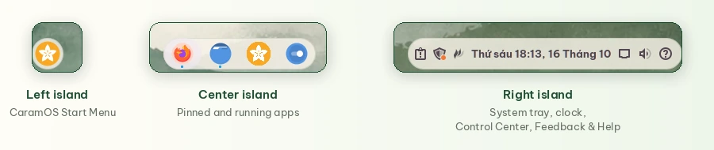

<p align="center">
  
</p>

<h1 align="center">CaramOS</h1>

<p align="center">
  <strong>Sweet & Simple Linux — A Linux distro made for Vietnamese users</strong>
</p>

<p align="center">
  <em>Caram = Carambola — the starfruit, whose 5 points mirror the star on Vietnam's flag, a fruit tied to every Vietnamese childhood</em>
</p>

<p align="center">
  <a href="https://github.com/VN-Linux-Family/CaramOS/releases/tag/v1.3.1"></a>
  
  
  <a href="LICENSE"></a>
</p>

<p align="center">
  <a href="https://sourceforge.net/projects/caramos/files/v1.3.1/CaramOS-1.3.1-cinnamon-amd64.iso/download"><strong>Download CaramOS 1.3.1</strong></a> ·
  <a href="https://caramos.vietnamlinuxfamily.net/?lang=en">Website</a> ·
  <a href="README.md">Tiếng Việt</a> ·
  <a href="https://vietnamlinuxfamily.net">VNLF</a>
</p>

<p align="center">
  
</p>

---

## What is CaramOS?

**CaramOS** is a Linux distribution based on **Linux Mint 22.3 Cinnamon** (Ubuntu 24.04 LTS),
made for **Vietnamese users**. Its goal is to make Linux easy for everyone moving from Windows:
Vietnamese out of the box, typing that just works, a friendly desktop, and everything else a few clicks
away.

> [!IMPORTANT]
> **CaramOS 1.3.1 is the latest release** of the official series that began with 1.3.0, after the 1.0.x
> Open Beta releases.
>
> - **New install:** [download the 1.3.1 ISO](https://sourceforge.net/projects/caramos/files/v1.3.1/CaramOS-1.3.1-cinnamon-amd64.iso/download)
>   (2.8 GB) · [SHA256SUMS](https://github.com/VN-Linux-Family/CaramOS/releases/download/v1.3.1/SHA256SUMS) ·
>   [release notes](https://github.com/VN-Linux-Family/CaramOS/releases/tag/v1.3.1)
> - **Already on CaramOS 1.0.2 or later:** no reinstall needed. The Update Center offers 1.3.1; click
>   **Update now**. See [Upgrading from an earlier release](#upgrading-from-an-earlier-release).

## What's new

### 1.3.1

- **A fully Vietnamese Start Menu:** "Tất cả ứng dụng" and "Biểu tượng cảm xúc" instead of English words;
  the weather applet and the bundled extensions follow the system language too.
- **An Update Center in one language:** the size line of an update no longer mixes in English.
- **The App Center names the source:** Zalo for Linux is labelled **Community package**, since the community
  packages it, not Zalo.

### 1.3.0 — the first official release

- **App Center:** at the first login, pick an office suite, browsers, chat apps and everyday tools;
  CaramOS downloads and installs them. Remove an app right from its card.
- **Driver Check:** checks the hardware at the first login and in the live USB session, and installs
  NVIDIA and Broadcom Wi-Fi drivers with one click.
- **Feedback & Help:** a question mark at the right end of the taskbar to ask for help, report a bug or
  send feedback to the Vietnam Linux Family community, with pictures or videos, and get notified when
  someone answers.
- **A new Update Center:** VNLF colours, every change listed, and the **Update now** button always at the
  bottom of the window.
- **Lighter than stock Linux Mint:** fewer background services, less RAM, and when memory runs out
  CaramOS closes the hungriest app instead of letting the machine freeze. The ISO is 2.8 GB, smaller than
  the Linux Mint 22.3 ISO (3.1 GB).
- **Nothing preinstalled you did not pick:** WPS Office, Chrome and Zalo now come from the App Center,
  CopyQ no longer starts at login, and 14 unused icon colours (about 1.1 GB) are removed.

## Highlights

### App Center — pick your apps, CaramOS installs them

<p align="center">
  
</p>

At the first login the App Center opens on a single page, grouped by purpose. A recommended set is
already selected: click **Install** at the bottom and keep using the computer while CaramOS downloads and
installs.

- **Office suites:** ONLYOFFICE, WPS Office, LibreOffice.
- **Browsers:** Google Chrome, Cốc Cốc, Microsoft Edge, Brave, Firefox.
- **Chat and meetings:** Zalo (with voice and video calls), Telegram, Zoom, Teams for Linux, Discord.
- **Everyday tools:** Microsoft fonts (Times New Roman, Arial...), VLC, OBS Studio, RustDesk, GIMP,
  Thunderbird.

<table>
  <tr>
    <td align="center"></td>
    <td align="center"></td>
  </tr>
</table>

Every app lists its strengths and weaknesses, its size and where it comes from: Flathub, the Ubuntu
archive or a downloaded package. Installed apps have a **Remove** button on their card. Open the
App Center any time from the Desktop or the menu; **See more** leads to
[apps.vietnamlinuxfamily.net](https://apps.vietnamlinuxfamily.net) for everything else.

### Driver Check — know what your computer is missing

<p align="center">
  
</p>

As soon as you try CaramOS from the USB stick, Driver Check tells you whether the computer works well
with it, before you install. After installing it runs again at the first login, then only speaks up
about new problems.

- Checks Wi-Fi, wired network, graphics, sound, Bluetooth, webcam and fingerprint reader.
- Installs the **NVIDIA** and **Broadcom Wi-Fi** drivers Ubuntu recommends for the machine, with one
  click.
- No network driver, so no Internet? It explains how to get online with a cable or a phone over USB, or
  installs the Broadcom driver straight from the CaramOS USB stick.
- Explains each case: no driver in the kernel yet, a driver waiting for a restart, a blocked driver
  (blacklist, Secure Boot), missing firmware.
- Stuck? **Ask for help** sends a message with the `hw-probe` hardware profile to the VNLF community.

### Update Center — upgrade without reinstalling

<p align="center">
  
</p>

CaramOS updates **over the air**: a machine installed from any release reaches the latest one without
reinstalling or losing data.

- CaramOS checks once a day. When there is a new release, the Update Center shows the current and the
  new version and every change that will be applied.
- Nothing is installed until you agree: click **Update now** when it suits you, or **Later**.
- What you changed yourself stays as it is: a wallpaper you picked, the icon colour you use, an applet
  you removed from the taskbar.

### Control Center — quick settings in one place

<table>
  <tr>
    <td align="center"></td>
    <td align="center"></td>
  </tr>
</table>

Click the right end of the taskbar to open the Control Center, which replaces Cinnamon's separate
network, sound and battery applets:

- Speaker and microphone volume, with the output and input device.
- Wired network, Wi-Fi, VPN and Bluetooth, each with its own list for quick choices.
- System-wide **Dark mode**, **Night light** and **Power mode** (Performance, Balanced, Power saver).
- Screen brightness and battery on laptops, a screenshot button, Settings, lock and power off.

### Feedback & Help — the VNLF community on your taskbar

<table>
  <tr>
    <td align="center" width="42%"></td>
    <td align="center"></td>
  </tr>
</table>

The question mark at the right end of the taskbar is a shortcut to the **Vietnam Linux Family**
community:

- **Ask for help** when something does not work, **Report a bug** when CaramOS or an app misbehaves,
  **Send feedback** when you have an idea for CaramOS.
- Attach screenshots (private parts can be blurred), screen recordings of up to a minute, or pictures and
  videos from the computer. They are made smaller and lose their location data before sending.
- Attach the hardware profile and the Driver Check results if you agree, so helpers see exactly your
  machine. The hardware profile leaves out user names, the computer's name and IP addresses.
- Requests are shared so the community can help too (you can untick it); VNLF reviews them before
  publishing, and your contact details are not made public.

<table>
  <tr>
    <td align="center"></td>
    <td align="center"></td>
  </tr>
</table>

The menu and the **Your requests** window show whether VNLF is looking at a request, has answered or has
resolved it, and how many answers the community gave. A new answer brings a notification that opens the
request's page.

### Island Dock — a taskbar of three islands

<p align="center">
  
</p>

The CaramOS taskbar is split into three rounded, floating, evenly spaced islands:

- **Left:** the CaramOS Start Menu.
- **Center:** pinned and running apps, with a small dot under the ones that are open.
- **Right:** system tray, input method, clock, Control Center and Feedback & Help.

### Light and dark, consistent from power-on

<p align="center">
  
</p>

- Cinnamon Delight theme, Tela Circle icons, Bibata cursor and the **Be Vietnam Pro** font.
- One-click dark mode in the Control Center; the wallpaper follows (Sage Mist in light mode, Indigo Night
  in dark mode). Five CaramOS wallpapers at 2048×1152.
- The boot menu, splash screen, installer and even the GRUB menu on dual-boot machines carry the
  CaramOS look.

### Vietnamese from the start

<p align="center">
  
</p>

- Vietnamese interface, Asia/Ho_Chi_Minh time zone and Vietnamese date formats. Pick another language
  in Settings > Languages and the whole system follows.
- **Fcitx5 + Lotus** is on from the start: Telex by default, with VNI and other common methods.
  **Ctrl+Shift** switches between English and Vietnamese, and the **`** key (below Esc) opens the
  method menu.
- Apps installed from Flathub type Vietnamese and use the system fonts as usual.

### Light and stable

- Based on **Linux Mint 22.3 / Ubuntu 24.04 LTS**, with security updates until 2029.
- **Less RAM:** 865 MiB in use when idle, against 941 MiB for stock Linux Mint 22.3 (same virtual
  machine with 4 cores and 6 GB of RAM, measured 5 minutes after boot).
- Fewer background services than stock Linux Mint: Cinnamon's services no longer load OpenGL for
  nothing, the input method no longer starts extra portals, the calendar reminder service runs only when
  you have a calendar, and the Ubuntu kernel crash reporter is off.
- **earlyoom:** when RAM and swap are nearly full, CaramOS closes the app using the most memory instead
  of letting the whole machine freeze. On a test machine with a slow disk, stock Linux Mint froze for
  over 30 minutes in this situation; CaramOS never stalled.
- A 2.8 GB ISO, smaller than the Linux Mint 22.3 ISO (3.1 GB), even with the App Center, Driver Check and
  Feedback & Help added.

## The CaramOS experience

| | |
|---|---|
| **Boot menu**<br>Try CaramOS from the USB stick or install it. |  |
| **Installer**<br>A slideshow about the App Center, typing and the community while it installs. |  |
| **Start Menu**<br>Search apps in Vietnamese, even typed without accents. |  |
| **Terminal**<br>CaramOS identity right in `neofetch`. |  |

<p align="center">
  
</p>

## Download and install

### System requirements

- A 64-bit (x86_64) computer, UEFI or BIOS.
- 2 GB of RAM or more, 4 GB recommended.
- 20 GB of free disk space or more, 100 GB recommended.
- A USB stick of 4 GB or more for the installer.

### 1. Download the ISO

- [CaramOS-1.3.1-cinnamon-amd64.iso](https://sourceforge.net/projects/caramos/files/v1.3.1/CaramOS-1.3.1-cinnamon-amd64.iso/download)
  (2.8 GB, on SourceForge because GitHub limits the size of each release file).
- [SHA256SUMS](https://github.com/VN-Linux-Family/CaramOS/releases/download/v1.3.1/SHA256SUMS) to check
  the download:

```bash
sha256sum -c SHA256SUMS
```

### 2. Write it to a USB stick

Use [balenaEtcher](https://etcher.balena.io), [Ventoy](https://www.ventoy.net) or Rufus (Windows). On
Linux you can use `dd`:

```bash
sudo dd if=CaramOS-1.3.1-cinnamon-amd64.iso of=/dev/sdX bs=4M status=progress oflag=sync
```

### 3. Try it and install

1. Restart the computer, open the boot device menu (usually F12, F10, F2, Esc or Del depending on the
   computer) and pick the USB stick.
2. Choose **Start CaramOS** to try it. Driver Check opens and tells you whether the computer works well
   with CaramOS.
3. Open **Install CaramOS** (Cài đặt CaramOS) on the Desktop and follow the steps.

## Upgrading from an earlier release

Machines with CaramOS installed do not need the ISO again.

- **From CaramOS 1.0.2 or later:** the Update Center checks every day and offers 1.3.1; click **Update
  now**. To upgrade right away, open a terminal and run:

  ```bash
  sudo caramos-ota --upgrade --yes
  ```

- **From CaramOS 1.0.1:** install the Update Center once, then open **CaramOS Update Center** from the
  Start Menu:

  ```bash
  curl -fsSL https://caramos.vietnamlinuxfamily.net/install-caramos-ota.sh | sudo bash
  ```

---

## For developers

> [!NOTE]
> Do not implement system changes directly in `config/hooks/live/` if those changes must reach
> machines that are already installed. Write migrations in `packages/caramos-ota` instead. See the OTA
> development guide: [packages/caramos-ota/README.md](packages/caramos-ota/README.md).

### Tech stack

| Component | Technology / current role |
|---|---|
| **Base ISO** | Linux Mint 22.3 Cinnamon 64-bit |
| **Ubuntu base** | Ubuntu 24.04 LTS / noble |
| **Desktop** | Cinnamon + LightDM from the Linux Mint base |
| **Build method** | ISO remaster: extract → customize → OTA bootstrap → repack |
| **Build scripts** | Bash + Makefile, split into modules under `scripts/` |
| **OTA** | `caramos-ota`: timestamp migrations applied through a ledger, published on `ppa:vietnamlinuxfamily/caram-os` |
| **Update Center** | `caramos-ota-notifier` + `pkexec caramos-ota --upgrade --yes` |
| **App Center** | `caramos-app-center` (Python, GTK4, libadwaita), its own repository, published as signed GitHub releases |
| **Driver Check, Feedback & Help** | `caramos-driver-check`, `caramos-help` (GTK4, libadwaita) and the `caramos-help@caramos` Cinnamon applet, in the `caramos-ota` package |
| **Control Center** | The `caramos-control-center@caramos` Cinnamon applet |
| **Legacy hooks** | `config/hooks/live/` is for bootstrap/build-time foundations, not new OTA features |
| **Overlay** | `config/includes.chroot/` stores base files copied into the ISO/rootfs |
| **Compression** | SquashFS `lz4` for dev builds, `xz` for releases |
| **Theme / Icons / Cursor** | Cinnamon Delight, Tela Circle, Bibata |
| **Font / Input Method** | Be Vietnam Pro, Fcitx5 + Lotus |
| **Included apps** | Firefox; everything else through the App Center (Flathub, the Ubuntu archive or downloaded packages) |

### Project structure

```text
./
├── build.sh                         # Main build script
├── Makefile                         # build/dev/release/debug targets
├── scripts/                         # ISO build modules
│   ├── config.sh                    # ISO version, base migration version, mirror, output
│   ├── extract.sh                   # Mount ISO + rsync + unsquashfs
│   ├── customize.sh                 # Chroot + packages + overlay + hooks + OTA bootstrap
│   ├── ota_bootstrap.sh             # Build caramos-ota and App Center .debs, run migrations in the rootfs
│   ├── repack.sh                    # mksquashfs + xorriso
│   └── boot_config.sh               # Boot menu + Plymouth branding
├── config/                          # ISO/rootfs bootstrap layer
│   ├── packages.txt                 # Base packages added to the ISO
│   ├── hooks/live/                  # Legacy build-time hooks, keep new logic out
│   └── includes.chroot/             # Overlay copied into the rootfs before OTA bootstrap
├── packages/
│   ├── caramos-ota/                 # Update Center, migrations, Control Center, Driver Check, Feedback & Help
│   └── caramos-app-center/          # Git submodule VN-Linux-Family/CaramOS-app-center
├── docs/                            # Operations and release tracking
├── assets/                          # Logos, banners, screenshots
├── Dockerfile                       # Docker builder
└── docker-compose.yml               # Docker build entrypoint
```

The landing page [caramos.vietnamlinuxfamily.net](https://caramos.vietnamlinuxfamily.net) lives in its
own repository, [VN-Linux-Family/caramos-landing](https://github.com/VN-Linux-Family/caramos-landing).

### Version and release model

The product version lives in the source tree, in [scripts/config.sh](scripts/config.sh):

```bash
CARAMOS_VERSION="1.3.1"
```

`make release VERSION=x.y.z` stamps it into `scripts/config.sh`, the release metadata and the
`caramos-ota` `debian/changelog` at once. The release tag must match it: version `1.3.1` is tag
`v1.3.1`, or GitHub Actions stops before building.

### OTA updates

```text
systemd timer
  └── caramos-ota --check
      ├── updates the caramos-ota package when the PPA has a newer build
      ├── updates the App Center from its signed GitHub release
      ├── resolves the migrations not applied yet, using the ledger
      └── writes /var/lib/caramos-ota/state.json

Update Center
  └── user confirms the update
      └── pkexec caramos-ota --upgrade --yes
          └── caramos-ota-update runs each migration
```

Important rules:

- The timer checks/prepares state; it does not open the GUI or apply migrations.
- Migrations run only after user confirmation or an explicit admin CLI command.
- System-changing logic lives in `packages/caramos-ota`, not in build hooks.
- Post-release changes are timestamp migrations (`YYYYMMDDHHMMSS_slug/`), not tied to a version.
- ISO builds use the same migration chain to bring the rootfs to latest.

See [packages/caramos-ota/README.md](packages/caramos-ota/README.md) for the OTA architecture and
developer workflow.

### Build the ISO

The build flow builds the `caramos-ota` package and the App Center, installs them into the rootfs and
runs the full OTA migration chain from `CARAMOS_MIGRATION_BASE_VERSION` to the latest release before
repacking. **The ISO is built as the latest state**, while OTA is the upgrade path for machines installed
from older ISOs.

```bash
sudo apt update
sudo apt install squashfs-tools xorriso rsync wget curl isolinux syslinux-common syslinux-utils gettext build-essential debhelper
git submodule update --init

make build                      # dev build, lz4
make release VERSION=x.y.z      # stamp the version and build a release, xz
make docker-build               # dev build inside Docker
make docker-release VERSION=x.y.z
```

Common `make` targets:

| Command | Purpose |
|---|---|
| `make build` | Full dev build with fast `lz4` compression |
| `make release VERSION=x.y.z` | Stamp the version, release build with `xz` compression |
| `make prepare` | Extract the ISO/rootfs into `build/` for fast iteration |
| `make customize-only` | Run package installation, overlay copy, and chroot hooks |
| `make boot-only` | Apply only boot menu, GRUB, and Plymouth branding |
| `make overlay` | Copy only `config/includes.chroot` into the rootfs |
| `make quick` | Prepare if needed, overlay, then repack squashfs and ISO |
| `make repack` | Repack squashfs and ISO from the existing work tree |
| `make iso-only` | Recreate only the ISO from `build/custom` |
| `make shell` | Enter the `build/squashfs` chroot for manual debugging |
| `make debug-iso` | Print boot menu/Plymouth diagnostics |
| `make clean` | Remove build/cache/output ISO artifacts |

### Releasing

[.github/workflows/build.yml](.github/workflows/build.yml) builds a dev ISO for pushes and pull requests
to `main` and `develop`. A `v*` tag checks that it matches `CARAMOS_VERSION`, builds the release ISO,
writes `SHA256SUMS`, uploads the ISO to SourceForge and creates the GitHub Release with its download
link.

```bash
make -C packages/caramos-ota prepare-release VERSION=1.3.1
git commit -am "[build] Release 1.3.1"
git push origin main
git tag -a v1.3.1 -m "CaramOS 1.3.1"
git push origin v1.3.1
make -C packages/caramos-ota source
make -C packages/caramos-ota gpg-unlock upload   # caramos-ota to the PPA, with the release GPG key
```

The App Center has its own version and release process, see
[VN-Linux-Family/CaramOS-app-center](https://github.com/VN-Linux-Family/CaramOS-app-center). The ISO bundles
the App Center from the submodule: when it has a new release, publish it and commit the submodule pointer
before tagging CaramOS.

### Contributing

We welcome contributions! See [CONTRIBUTING_EN.md](CONTRIBUTING_EN.md) for the OTA-first contribution
workflow.

**You can help with:**
- Bug reports and feature suggestions via [Issues](https://github.com/VN-Linux-Family/CaramOS/issues),
  or the Feedback & Help question mark on CaramOS itself
- Wallpaper, icon, theme, and branding design
- Testing ISO and OTA updates on different hardware or VM snapshots
- Documentation and translations
- Writing safe OTA migrations, package changes, build scripts, and base overlays

## Contributors

Thanks to everyone who has contributed to CaramOS on GitHub.

<p align="center">
  <a href="https://github.com/VN-Linux-Family/CaramOS/graphs/contributors">
    
  </a>
</p>

## License

CaramOS is open-source software licensed under [GPL-3.0](LICENSE).

## Acknowledgments

- [Linux Mint](https://linuxmint.com/) — Outstanding base distribution
- [Ubuntu](https://ubuntu.com/) — Stable LTS foundation through Linux Mint
- [VNLF (Vietnam Linux Family)](https://vietnamlinuxfamily.net) — Vietnamese Linux community
- [DrMcC0y](https://github.com/DrMcC0y) — Cinnamon Delight theme/icons
- [vinceliuice](https://github.com/vinceliuice) — Tela Circle icons
- [ful1e5](https://github.com/ful1e5) — Bibata cursor
- Fcitx5 and Lotus contributors — Vietnamese input method support

---

<p align="center">
  <strong>CaramOS</strong> — Sweet & Simple Linux<br>
  Made with love by <a href="https://vietnamlinuxfamily.net">Vietnam Linux Family</a>
</p>
